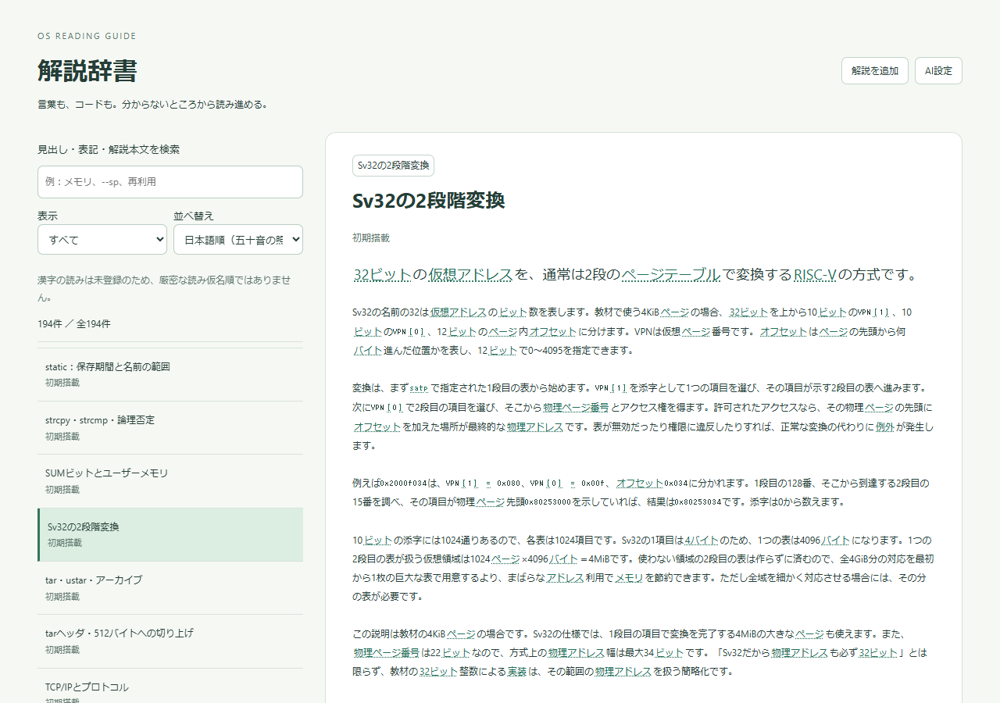
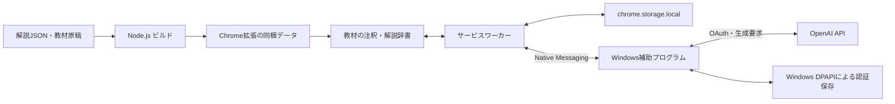

# OS読書ガイド

OSの教材を読みながら、分からない用語やコードの意味をその場で確認するChrome拡張です。[『1000行でOSを作ってみよう』日本語版](https://operating-system-in-1000-lines.vercel.app/ja/)の全18章を対象に、194件の解説を収録しています。教材著者とは独立した非公式の学習支援ツールです。

## 読書を止めずに、前提知識をたどる

OSの学習では、メモリやCPUの知識に加え、Cやアセンブリの細かな構文も必要になります。一つの用語を調べると、その説明にも知らない用語が現れます。この拡張は、教材の本文・コードから補足を開き、関連する知識をたどって元の説明へ戻れるようにするために作っています。

1. 教材の点線付きの表現にカーソルを合わせると短い説明が表示されます。クリックすると固定できます。
2. 「詳しい説明を読む」で、背景・具体例・図解を確認できます。
3. 説明中の別の用語から関連解説へ進み、「戻る」で読んでいた説明へ戻れます。


実Chromeで撮影した図解の一例です。33項目に34図を収録し、ビットの内訳、メモリの配置、処理の順序などを表します。「図を文章で読む」から文字でも確認できます。

## 調べる・書き足す・読み直す



個人データのないChromeプロファイルで撮影した、現在の辞書画面です。

拡張アイコンから開く解説辞書では、説明本文まで検索し、登録元で絞り込みできます。自分の説明を追加・編集し、JSONで書き出して別の環境へ持ち込めます。初期解説を編集した場合は個人編集を優先し、必要な項目だけ元の説明に戻せます。

Windowsでは、選択したコードや入力した表現についてChatGPTで説明を生成する機能もあります。生成に送る文脈を確認でき、結果には「AI生成・内容未確認」を表示します。保存済み解説の閲覧と手動編集にはChatGPT接続は不要です。

## 実装で工夫したこと

| 読書中に起きる課題 | 実装での対応 |
|---|---|
| 色分けされたコードでは、一つの構文が複数のHTML要素に分かれる | テキストとDOMの位置を対応付けて要素をまたいで照合。`*--sp`のような構文も注釈し、本文とコピー内容の同一性を検証 |
| 同じ表記でも章や文脈で意味が変わる | 最長一致・識別子境界・章別の優先度で候補を処理。複数の意味はポップアップで選択 |
| 教材と辞書を別タブで編集すると保存が競合する | サービスワーカーで更新を直列化し、古い編集の保存時に競合を検出。変更を各画面へ通知 |
| 関連する説明をたどると、読んでいた場所を失う | 戻れる履歴を最大24件保持。学習順序を示す前提関係は非循環にし、関連解説へのリンクは往復可能 |
| 生成された図を安全に表示したい | 上限と形式を持つJSONを検証し、拡張側でDOM・SVGを構築。保存・読み込み・生成で共通の検査を使用 |

照合・保存・図解・認証のテストと、実ブラウザでの確認範囲は [検証結果](TEST-REPORT.md) に記載しています。学習効果の利用者実験は未実施です。

## 構成

JavaScript、HTML、CSSで実装したManifest V3拡張です。解説はJSON、ビルドとWindows補助プログラムはNode.js、登録と暗号化の連携はPowerShellを使います。



AI生成時は選択文字列、章、URL、周辺の本文・コード、関連解説を送信します。認証情報はWindows側で暗号化して保存します。実装の入口と保存仕様は [開発ガイド](docs/DEVELOPMENT.md) にまとめています。

## 試す

Node.js 22以上、Git、Chromeを用意します。検証環境はWindows版Chromeです。

```sh
git clone https://github.com/JP-Japanese-JP/os-reading-guide.git
cd os-reading-guide
npm run build
```

1. Chromeで `chrome://extensions` を開き、デベロッパーモードを有効にします。
2. 「パッケージ化されていない拡張機能を読み込む」で、このリポジトリの `extension` フォルダーを選びます。
3. [第9章「メモリ割り当て」](https://operating-system-in-1000-lines.vercel.app/ja/09-memory-allocation)を開きます。開いていた場合は再読み込みし、本文の点線や「読書ガイド」を確認してください。
4. 拡張アイコンを押すと解説辞書を開けます。

通常のビルドに外部npm依存パッケージのインストールは不要です。AI生成を使う場合は、Windowsで `setup-helper.cmd` を実行し、[INSTALL.html](INSTALL.html) をローカルのブラウザで開いて接続手順を確認してください。利用可能なモデル・認証・利用枠はサービスとアカウントの条件に依存します。拡張側からクレジット利用設定を自動確認できないため、AI設定では利用者による確認を求めます。

## 詳しく知る

- [操作・AI接続・更新・困ったとき](INSTALL.html) — ダウンロード後、ブラウザで開く手順書
- [開発ガイド](docs/DEVELOPMENT.md) — ファイル構成、編集、テスト、資料の探し方
- [検証結果と限界](TEST-REPORT.md) — 実測・模擬応答・未確認事項
- [図解の仕様](research/DIAGRAMS.md) — データ形式と描画・保存の設計

対象は教材の日本語版です。段落や独立したコード要素をまたぐ一括照合には対応していません。教材の更新によって注釈や章リンクが一致しなくなる可能性があります。解説には誤りが含まれる可能性があり、出典と教材に照らして確認できるようにしています。

## 出典とライセンス

拡張・補助プログラム・独自解説は [MITライセンス](LICENSE) です。同梱した教材原稿はSeiya Nuta氏の著作物で、CC BY 4.0の対象です。出典と各資料の扱いは [NOTICE.md](NOTICE.md) を参照してください。
